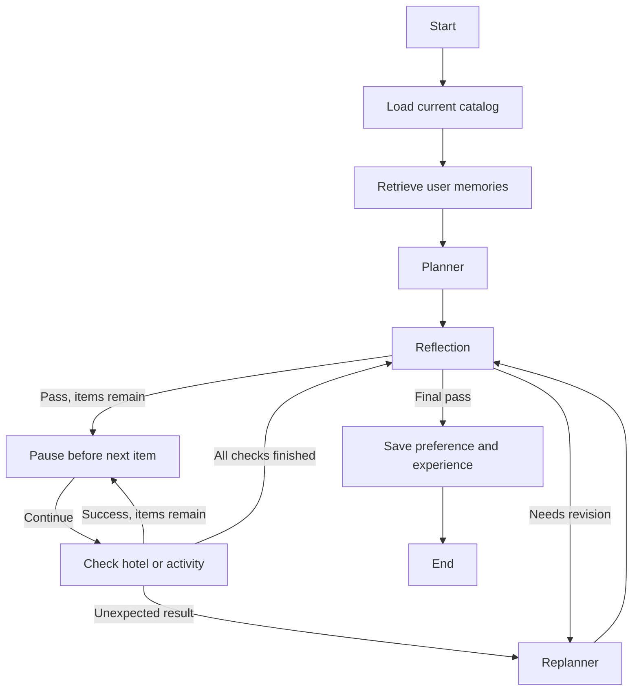

# LangGraph Itinerary Agent

A learning project demonstrating **planning, step-by-step execution, replanning, reflection, and semantic memory**. It calls the sibling `itinerary_guide` FastAPI app, uses GPT-OSS 20B through OpenRouter, and stores memories in Qdrant using local Ollama Nomic embeddings.

Every executed item is a **simulated availability check**, not a reservation. Travel prices are fictional INR amounts from the sample API.

## 1. Setup and run

Requirements: Python 3.11+, `uv`, the existing travel app, local Ollama, and access to your Qdrant collection.

```powershell
cd 'C:\Salmon\Edureka\AI agents\Advanced_agents\itinerary_generator_agent'
uv sync
ollama list
```

`nomic-embed-text:latest` is already installed on this computer and was tested with 768-dimensional embeddings. If setting this project up on another computer, install Ollama, start it, and run `ollama pull nomic-embed-text`.

The project reads the existing shared file:

```text
C:\Salmon\Edureka\AI agents\.env
```

Required keys: `OPEN_ROUTER_API_KEY` (also accepts `OPENROUTER_API_KEY`), `QDRANT_ENDPOINT`, and `QDRANT_API_KEY`. Keep actual credentials in that file; no keys need to be pasted into the UI. Local Ollama does not need the cloud Ollama API key. This project does not modify `.env` or load its unrelated settings into the process environment.

Start these in separate terminals:

| Terminal | Working directory | Command |
|---|---|---|
| 1: Travel API | `itinerary_guide` | `uv run uvicorn backend.main:app --reload` |
| 2: Existing catalog/simulator UI | `itinerary_guide` | `uv run streamlit run frontend/app.py` |
| 3: Agent UI | `itinerary_generator_agent` | `uv run streamlit run app.py --server.port 8502` |

- Agent: <http://localhost:8502>
- Availability simulator: <http://localhost:8501>
- Travel API docs: <http://127.0.0.1:8000/docs>
- Ollama default endpoint: <http://127.0.0.1:11434>

Alternatively, use the interactive CLI from this project folder:

```powershell
uv run python main.py --destination jaipur --user-id alex --budget 20000 --preferences 'Local food, culture, and a relaxed pace'
```

Press Enter for each next check. Enter `q` to stop. CLI options also include `--nights`, `--rooms`, `--travelers`, `--food`, `--transport`, and `--misc`.

## 2. Watch a replanning example

1. Open the agent UI. Choose **Jaipur**, two nights, one room, two travelers, and a ₹20,000 whole-trip budget. Jaipur has two initially available hotels, making replacement easy to observe.
2. Click **Generate initial plan**. The graph retrieves memories, produces a structured itinerary, evaluates it, and pauses before checking the chosen hotel.
3. In the existing simulator UI, select the hotel shown in the agent's next step and make it unavailable. Keep the other Jaipur hotel available.
4. Back in the agent, click **Continue next step**. The fresh API result triggers the replanner. The UI shows the original plan, revised hotel, revision reason, new scores, and refreshed budget.
5. Continue to check the replacement hotel. Before a pending activity check, you can similarly make that activity unavailable. The replanner may replace or remove pending activities, using free time when appropriate.
6. Continue until the run is complete. Final validation checks the entire itinerary again, then persists your explicit preferences and the observed experience.

The executor does not change availability itself. The simulator controls the unexpected results. If a failure cannot be resolved within the constraints, the agent returns **incomplete**, rather than claiming success.

## 3. Understand the graph



Unrecoverable service failures, impossible plans, and exhausted revisions also terminate through the memory-saving node when memory is available.

### Planner

Selects one hotel and a day-by-day schedule using actual catalog IDs. A trip has `nights + 1` day entries, with at most two activities per day. An activity is selected at most once. Rest/free time is allowed and has no added catalog cost. The model proposes a plan; Python and the API validate it.

### Executor and pause/resume

Checks the hotel first, then activities in day order. Each successful step records the returned catalog item and a factual observation. A fresh unavailable/missing item or changed price is an unexpected result.

The pause is its own node, containing a LangGraph `interrupt()` before any API calls or writes. Resume uses `Command(resume=True)` with the same thread ID. Re-running the pause therefore does not repeat a completed tool action. Calling continue on a finished run only reads its checkpoint.

### Replanner

Receives fresh catalog data, observations, completed steps, and reflection feedback. It can change pending selections and add pending checks. It must preserve the completed hotel and completed activities' IDs/day numbers. New activities cannot be inserted before the last completed activity's day. Proposed revisions that change completed choices are rejected.

Unexpected results and reflection failures share a limit of **three revisions per run**. If a completed choice later becomes unavailable, the run stops incomplete and asks for a new run; a successful simulated check never reserved that item.

### Reflection evaluator

| Criterion | How it is checked |
|---|---|
| Budget | The travel API quote must stay within the whole-trip budget |
| Availability | Current catalog items must be available |
| Preferences | The LLM checks explicit preferences or relevant recalled preferences |
| Day coverage/pacing | Python checks day coverage and limits; the LLM checks the proposed pace |
| Catalog grounding | IDs must exist at the selected destination; activities must be unique |

Each criterion scores 0–2. Passing requires at least **8/10**, no criterion at zero, and all deterministic checks to pass. Budget, availability, and grounding each require a full deterministic pass. Reflection runs initially, after revisions, and after the final simulated check. Low scores automatically send concrete feedback to the replanner. The model cannot override failed Python checks.

Model outputs are parsed into Pydantic models. Invalid JSON receives one repair attempt; repeated invalid output stops with a readable error. Node traces show results and concise decision summaries, not private chain-of-thought.

## 4. Budget and memory

The agent sends selected IDs and trip counts to `/budget/calculate`; it never accepts model-invented prices.

```text
Hotel     = nightly price × nights × rooms
Activities = sum of per-person prices × travelers
Total     = hotel + activities + food + transport + miscellaneous
```

Extras are group totals for the entire trip. Rooms are entered manually. There are no automatic taxes, occupancy calculations, dated inventory, flights, or real bookings.

### Persistent Qdrant memory

- Reuses **Edureka**. It never creates, deletes, or recreates the collection.
- Checks for 768-dimensional cosine vectors and preserves its existing empty-string vector name. An ordinary unnamed-vector collection is also supported without conversion.
- Calls local Ollama `/api/embed` with `search_document:` for stored text and `search_query:` for queries. A cold model load can take a minute; the embedding timeout is 120 seconds.
- Adds payload indexes for application ID, user ID, embedding model, and test status. Existing points are preserved.
- Retrieves the five most similar records for this application/user/model/test status. It does not retrieve arbitrary documents from the same collection.
- Saves explicit preference text and a factual experience summary at termination, including unsuccessful runs when memory is available. Stable UUIDs based on run/user/type make repeated writes idempotent.
- Current explicit instructions override historical preferences. Retrieved failures do not permanently blacklist items, and historical prices never replace current API results.
- Memory initialization/retrieval failures stop the run clearly. A final memory-write failure retains the itinerary result but displays **persistence not confirmed**.

To observe recall, finish a trip as user `alex`, then start another trip with the same user ID and leave preferences blank. Inspect the Qdrant memory tab. Use a different ID to see an independent history. User IDs are local demo namespaces, not an authentication system.

### Checkpoints versus memories

`InMemorySaver` holds the active graph checkpoint, keyed by a unique run/thread ID. It survives Streamlit widget reruns within that session, but not a process restart or configuration reload. Qdrant holds long-term preferences and experiences across restarts. No global shared graph is cached between UI sessions.

Optional settings can be placed in the shared `.env` or process environment; a nonempty file setting wins:

| Setting | Default |
|---|---|
| `OPENROUTER_MODEL` | `openai/gpt-oss-20b` |
| `TRAVEL_API_URL` | `http://127.0.0.1:8000` |
| `OLLAMA_BASE_URL` | `http://127.0.0.1:11434` |
| `OLLAMA_EMBED_MODEL` | `nomic-embed-text:latest` |
| `QDRANT_COLLECTION` | `Edureka` |

Use **Reload configuration** after changing credentials. It discards the active run but preserves saved memories. Changing the embedding model requires matching vector dimensions and consistent historical embeddings; it is not an automatic collection migration.

## 5. Find the code

```text
itinerary_generator_agent/
├── app.py                    # Streamlit inputs, continuation controls, and result tabs
├── main.py                   # Interactive CLI using the same runtime
├── agent/
│   ├── config.py             # Shared .env and configurable service settings
│   ├── models.py             # Typed trip, itinerary, observation, and score models
│   ├── state.py              # Graph state and step-list helpers
│   ├── graph.py              # Nodes, edges, routing, and checkpointer
│   ├── runtime.py            # start_trip(), continue_trip(), and run views
│   ├── services.py           # Groups injectable service dependencies
│   ├── tools.py              # Travel API HTTP calls and quote validation
│   ├── llm.py                # OpenRouter calls, JSON validation, one repair attempt
│   ├── memory.py             # Ollama embeddings, Qdrant retrieval and persistence
│   ├── validation.py         # Deterministic plan and completed-step checks
│   ├── errors.py             # Readable external-service failures
│   └── nodes/
│       ├── context.py        # Current catalog and shared planning instructions
│       ├── planner.py        # Initial structured plan
│       ├── executor.py       # Pause node and one-item execution node
│       ├── replanner.py      # Revise pending work from feedback
│       ├── evaluator.py      # Hard checks and model-assisted rubric
│       └── memory_nodes.py   # Retrieve and save graph nodes
├── scripts/live_check.py     # Optional real-service verification
├── tests/                    # Offline graph, memory, service, CLI, and UI tests
├── pyproject.toml
└── uv.lock
```

Start by reading `graph.py`, then follow each node's function. Nodes return partial state updates; routing stays in the graph. Services are injected so tests can control observations without API keys or charges.

## 6. Verify it

```powershell
uv run pytest -q
```

Normal tests are offline: scripted models, controlled tools, HTTP mock transports, a local in-memory Qdrant collection, and Streamlit AppTest. They cover pause/resume, unexpected results, preserved completed work, rubric repair, budget failures, revision limits, malformed responses, user/test memory isolation, stable memory IDs, and visible UI failures.

For explicit **live** verification while the travel API is running:

```powershell
uv run python -m scripts.live_check
```

This calls OpenRouter and local Ollama, writes to Edureka, and verifies semantic retrieval with a paraphrased query. Verification records remain clearly tagged `is_test=true` and `user_id=itinerary-agent-live-check`; normal runs exclude them. Live model calls consume API credits.

To additionally exercise hotel replanning against a test travel API:

```powershell
uv run python -m scripts.live_check --travel-url http://127.0.0.1:8000 --simulate-hotel-failure
```

That explicit flag briefly makes the selected hotel unavailable, then restores it. Use a separate travel API instance if others are experimenting with the simulator. This project does not introduce a new agent HTTP server.

References: [LangGraph interrupts](https://docs.langchain.com/oss/python/langgraph/interrupts), [LangGraph workflows](https://docs.langchain.com/oss/python/langgraph/workflows-agents), [Qdrant filtering](https://qdrant.tech/documentation/search/filtering/).
