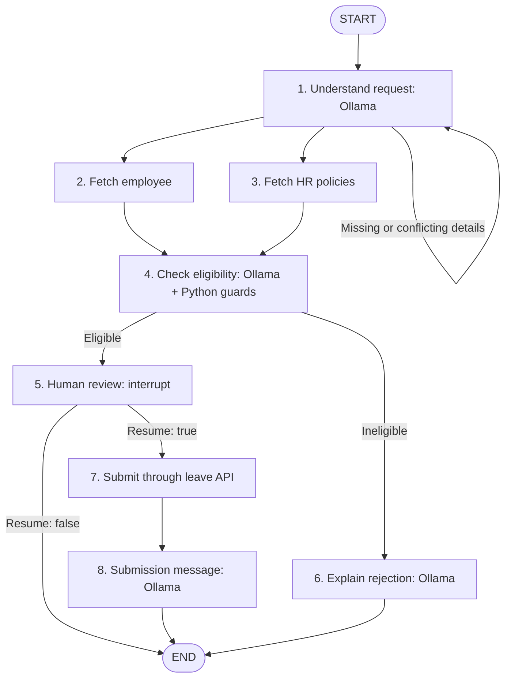

# LangGraph Leave Application PoC

An interactive terminal project with eight LangGraph nodes, Ollama Cloud
`gpt-oss:20b`, parallel local API calls, conditional routing, and human review
through `interrupt()` / `Command(resume=...)`.

## Setup

Use Python 3.10 or later. In PowerShell:

```powershell
cd "C:\Salmon\Edureka\AI agents\LangGraph\langGraph_PoC"
& "C:\Users\salmo\AppData\Local\Programs\Python\Python311\python.exe" -m venv .venv
.\.venv\Scripts\python.exe -m pip install -r requirements.txt
.\.venv\Scripts\python.exe main.py
```

The app reads `OLLAMA_API_KEY` and `MONGODB_URI` from:

```text
C:\Salmon\Edureka\AI agents\.env
```

The file's values take precedence over inherited environment variables. If the
file does not supply a value, the corresponding environment variable is used. Missing
configuration produces an error before a workflow starts. Credentials stay out
of graph state, prompts, and terminal output. No local Ollama installation or
model download is needed for the cloud endpoint.

At startup, MongoDB connectivity is checked and the app creates or reuses
`Edureka.conversation_messages`. The URI's embedded credentials are used directly.
The terminal prints a conversation ID for the session and a separate workflow
thread ID for each leave request.

Keep these existing services running in separate terminals:

| Service | Base URL | Endpoint used |
| --- | --- | --- |
| Employee details | `http://127.0.0.1:8000` | `GET /employees/EMP004` |
| Dummy HR policies | `http://127.0.0.1:8001` | `POST /policies/search` |
| Leave application storage | `http://127.0.0.1:8002` | `POST /leave-applications` |

Defaults, including the fixed employee `EMP004`, live in `config.py`.
Local API timeouts are 10 seconds; the Ollama timeout is 120 seconds.

## Try a request

Enter a request with future dates, for example:

```text
I need 3 working days of annual leave starting 2026-11-16 for a family vacation.
```

Choose future dates relative to when you run the demo. If details are missing
or conflicting, the graph pauses and asks a follow-up question. For example:

```text
Leave request: I need leave from November 16 to November 18.
What is the reason for your leave?
Your answer (or /cancel): Family vacation
```

If eligible, the terminal displays the employee, dates, working-day count,
reason, available balance, and policy explanation. Enter `yes` or `y` to submit,
or `no` or `n` to cancel. Other confirmation answers are rejected and prompted
again. An explicit confirmation is required before calling the leave API.

After submission the response includes the application ID and dates. The leave
API saves the record in `leave_apply/leave_applications.jsonl`. It records an
application; manager approval is a later step. The demo does not deduct leave
balance. Enter `/quit` at the request prompt to exit; `/cancel` abandons a
clarification.

## Graph



The implementation uses one joint edge from Nodes 2 and 3 to Node 4. This waits
for both parallel branches and executes eligibility once. Service failures end
the run with an error; they are not treated as policy rejections.

## Read the code

| File | Responsibility |
| --- | --- |
| `main.py` | Terminal input, node progress, interrupt handling, and resume commands |
| `workflow.py` | Eight nodes, graph wiring, date arithmetic, and eligibility guards |
| `models.py` | Pydantic request/response contracts and the typed shared state |
| `clients.py` | Async HTTP calls, Ollama prompts, JSON parsing and one repair attempt |
| `config.py` | API URLs, model, timeouts, fixed employee and credential loading |
| `conversation_memory.py` | Message state, MongoDB storage, recent context, and transcript helpers |
| `workflow_persistence.py` | SQLite checkpointer lifecycle, recovery validation, and cancellation |
| `tests/test_workflow.py` | Graph, client, CLI, and configuration tests with fake services |
| `tests/test_conversation_memory.py` | Mocked MongoDB storage, conversation, and resume tests |
| `tests/test_workflow_persistence.py` | Restart recovery and failure tests using temporary SQLite files |

The terminal uses `StateGraph(LeaveState)` and `AsyncSqliteSaver`. Calling
`build_graph(clients)` without a checkpointer still uses `InMemorySaver`, which
keeps existing tests and programmatic examples compatible. `LeaveState` inherits
`MessagesState` through `ConversationState`, adding the `messages` channel with
the `add_messages` reducer and a `conversation_id`. State also carries the
original request, clarification history, reference date, extracted details,
leave dates/count, employee, chunks, eligibility verdict, confirmation, saved
application, error, and final message. Nodes return partial state updates. The
parallel nodes write separate fields to avoid competing updates.

Each new terminal request gets a fresh UUID `thread_id`. Clarification and
confirmation resume the same thread with `Command(resume=answer)`. The terminal
saves workflow checkpoints and pending interrupts to SQLite. Conversation
messages are stored in MongoDB. Both survive restarting the app.

## SQLite workflow recovery

The terminal creates `workflow_state.sqlite` next to `workflow_persistence.py`,
independent of the current working directory. LangGraph creates its checkpoint
tables automatically. The database and its SQLite journal/WAL files are ignored
by Git. No SQLite server or additional environment configuration is required.
Run `pip install -r requirements.txt` in your chosen Python environment after
updating this project to install the checkpoint driver.

Copy the printed workflow **Thread** ID before closing a session. To restore it:

```powershell
.\.venv\Scripts\python.exe main.py --resume-thread "PREVIOUS_THREAD_ID"
```

The app restores the saved state and reconnects to its original MongoDB
conversation. `--conversation-id` is optional when resuming, and a conflicting
ID is rejected. It does not create a new initial request or repeat completed
lookup nodes. A saved clarification or confirmation is displayed again for your
answer. A completed workflow displays its stored result. Other unfinished work
continues from its checkpoint, including generating a receipt message when the
saved state already contains the submission receipt.

Each streamed graph step uses `durability="sync"`, saving the checkpoint before
the next node starts. The checkpoint contains the workflow data and message
state, not service clients or credentials. `/cancel` marks the workflow
cancelled and closes its pending path, including after restarting.

If a workflow stopped at the submission node without a saved receipt, recovery
does not repeat the POST: the API may already have saved it before the process
stopped. Inspect `leave_apply/leave_applications.jsonl` before submitting again.
The API POST and checkpoint write are separate operations, so SQLite does not
guarantee exactly-once submission after an abrupt crash.

Use one application process per SQLite file. Missing threads and database
access failures produce an error. The app does not silently switch to in-memory
storage or reset an existing database. Workflows from earlier in-memory sessions
cannot be recovered; only runs saved after enabling SQLite are available.

## MongoDB conversation history

The terminal saves requests, clarification questions/answers, review summaries,
confirmation decisions, cancellations, errors, and final replies. It stores
user-visible text rather than internal API payloads or model reasoning. Each
message document includes its conversation ID, workflow thread ID, message ID,
sequence, UTC timestamp, and LangChain-serialized message.

One terminal session uses one conversation ID. Each leave request starts a fresh
workflow thread, so prior confirmations and submitted application records do not
authorize a new application. Extraction receives the latest 20 messages as
reference context; the full transcript is retained in MongoDB. Current input and
clarification answers take precedence over earlier context.

To reopen a transcript, copy the printed conversation ID and run:

```powershell
.\.venv\Scripts\python.exe main.py --conversation-id "YOUR_CONVERSATION_ID"
```

`--conversation-id` loads messages for a new workflow. Use `--resume-thread` to
restore an existing workflow instead. Use one active terminal writer per conversation
ID. Message IDs are upserted in MongoDB and merged by LangGraph, preventing
duplicate messages when the same event is recorded again.

MongoDB must be reachable before requests are accepted. A failed transcript
write stops the current request before resuming toward submission. If saving the
final reply fails after submission, the API receipt is displayed first and the
history error is reported without repeating the leave POST.

Node 1 checkpoints its clarification question through a self-loop before
interrupting. When resumed, the saved question is encountered before another
LLM call; the answer is added to clarification history and extraction resumes.
Node 5 only reviews the saved request and records a Boolean decision. All leave
submission side effects are isolated in Node 7, after human review.

To inspect the graph in Python, construct it with `build_graph(clients)` and
keep the returned compiled graph. `await graph.aget_state(config)` exposes the
saved state for that thread. The CLI's `run_request` function shows how to
stream updates, inspect interrupts, and resume without restarting a request.

## Date and policy behavior

- The reference date is captured when each request starts, in `Asia/Kolkata`.
  Relative dates are resolved by Ollama with explicit date anchors. “Next
  Monday” means the first Monday strictly after that date. A month/day without
  a year uses its next occurrence on or after that date.
- Python counts Monday-Friday dates inclusively and ignores holidays. With a
  start date and explicit day count, Python derives the end date; a weekend
  start begins counting on the following Monday. Same-day weekday leave is one
  day. Weekend-only ranges are ineligible.
- Missing dates or reasons, reversed dates, and stated counts that conflict
  with the dates cause clarification. Unspecified leave type defaults to
  `annual`. Reasons are never filled in automatically.
- Ollama assesses the returned policy chunks and must provide reasons and
  supporting chunk IDs. Python blocks eligibility for past dates, zero working
  days, insufficient balance, missing evidence, or nonexistent chunk IDs, even
  if the model proposes eligibility.
- Policy notice counts weekdays after the reference date through the leave
  start date, including the start date. The model evaluates the three-working-day
  notice rule for planned annual leave using that supplied count. Manager
  approval is not required to submit an application.
- Unsupported policy conclusions are ineligible. Policy evaluation remains an
  LLM judgment for this learning project; the supplied HR policies are dummy text.

## Errors and submission behavior

The project prompts for JSON and validates it with Pydantic rather than relying
on cloud schema enforcement. Invalid structured answers get one repair attempt.
Only final model content is used; reasoning is not printed or stored in state.

Lookup or model failures stop the run before submission. The leave POST is
never automatically retried. A timeout, connection failure, server/storage
error, or invalid receipt produces an unknown-outcome message: inspect the
JSONL file before submitting again. The backend has no idempotency key, so the
project cannot guarantee exactly-once storage after an ambiguous network failure.

If rejection-message generation fails, the recorded reasons are displayed. If
success-message generation fails after the application is saved, the app
returns a factual receipt from the saved API response without repeating the POST.

## Tests

From the parent `LangGraph` directory, after installing the requirements:

```powershell
.\langGraph_PoC\.venv\Scripts\python.exe -m unittest discover -s langGraph_PoC/tests -v
```

Tests use fake LLMs and mocked HTTP, and never submit to the running leave API.
MongoDB tests also use a fake collection and require no live database.
SQLite recovery tests close and reopen temporary database files with fake
service clients. They cover confirmation and clarification recovery, completed
and cancelled workflows, conversation mismatch, thread isolation, ambiguous
submission prevention, and database errors. No live leave application is submitted.
They cover date/count handling, configuration, JSON repair, true parallel lookup
execution and the join, clarification/resume, human approval/cancellation,
eligibility guards, thread isolation, error handling, exact API payloads, and
submission retry prevention.

References: [LangGraph interrupts](https://docs.langchain.com/oss/python/langgraph/interrupts),
[Ollama Cloud](https://docs.ollama.com/cloud), and
[Ollama structured outputs](https://docs.ollama.com/capabilities/structured-outputs).
